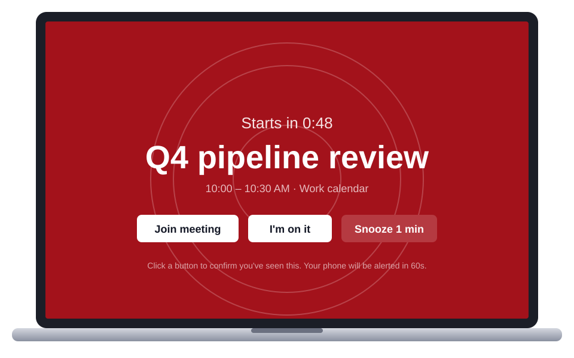
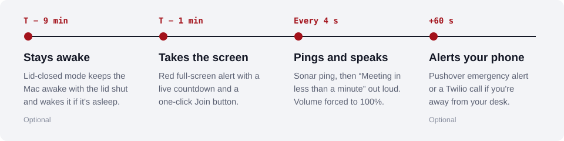
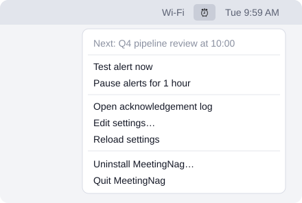
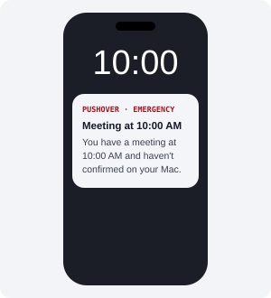

# MeetingNag

**The meeting reminder you can't ignore.**

Calendar pop-ups are easy to miss when you're heads-down. MeetingNag takes over your whole screen 1 minute before every meeting and keeps pinging until you click to confirm you've seen it. It's free and runs on your Mac.



<sub>It covers every screen and Space, even over full-screen apps. The meeting shown is an example.</sub>

## It escalates until you answer

Each step only happens if you haven't clicked yet.



## What you get

| | |
|---|---|
|  | **Runs in the menu bar.** Reads Google Calendar through the macOS Calendar app. It skips solo blocks, declined invites and anything titled Focus or OOO. |
|  | **Private by design.** It never speaks or sends the meeting title. The voice and phone alerts only say that a meeting is coming up. |

**Logs every confirmation.** Each alert, whether you joined, snoozed or needed your phone, and how many seconds it took:

| meeting_start | action | seconds_after_alert |
|---|---|---|
| 09:00 | alert_shown | 0 |
| 09:00 | joined | 7 |
| 11:30 | alert_shown | 0 |
| 11:30 | escalated_to_phone | 60 |
| 11:30 | acknowledged_after_escalation | 94 |

## The 30-second version

> I kept missing meetings because calendar pop-ups are easy to tune out. MeetingNag takes over my Mac's screen a minute before every meeting. It pings and counts down out loud at full volume until I click to confirm. If I'm away from my desk, it alerts my phone. It's free, it keeps meeting names private, and it logs every confirmation.

Free · source included · macOS 13+ · Google Calendar via macOS Calendar · about 5 minutes to set up. A one-page version of this pitch is in [`docs/pitch.html`](docs/pitch.html).

## Setup (about 5 minutes)

1. **Connect Google Calendar to macOS.** Go to System Settings › Internet Accounts › Add Account › Google and sign in with your work account. Make sure **Calendars** is turned on.
   To pick up last-minute changes faster, open the Calendar app and go to Settings › Accounts › your Google account. Set **Refresh Calendars** to the shortest interval it offers.
2. **Build the installer (once).** Clone or download this repo, open Terminal in its folder, and run:
   ```
   bash build-pkg.sh
   ```
   If macOS asks you to install the Command Line Tools, click **Install**, then run the command again. This creates **MeetingNag-1.4.pkg** in the same folder. It works on both Apple silicon and Intel Macs.
3. **Install.** Double-click the .pkg. On the **Installation Type** screen you can tick **Lid-closed mode** (it's off by default). The installer replaces any previous MeetingNag, including the older Terminal install, and keeps your settings.
4. **Allow calendar access and Accessibility** when macOS asks, then click **⏰ › Test alert now**.

MeetingNag starts automatically when you log in. To remove it, choose **⏰ › Uninstall MeetingNag…**, or run `sudo bash /Applications/MeetingNag.app/Contents/Resources/uninstall.sh`.

**Sharing the .pkg with others.** An unsigned .pkg installs fine on the Mac that built it. On another Mac, macOS blocks it until the person clicks **System Settings › Privacy & Security › Open Anyway**. To avoid that, sign and notarize it with an Apple Developer ID; the top of `build-pkg.sh` shows how.

## How you know the alert was seen

Every alert is written to **⏰ › Open acknowledgement log**, a CSV file with these columns: `logged_at, meeting, meeting_start, action, seconds_after_alert`.

The `action` column records `alert_shown`, `acknowledged`, `joined`, `snoozed` or `escalated_to_phone`. An action that came after a phone alert ends in `_after_escalation`.

The buttons stay disabled for the first 1.5 seconds. This stops a stray keystroke or click from dismissing the alert while you're typing.

## Settings

Choose **⏰ › Edit settings…**, save the file, then choose **⏰ › Reload settings**.

| Key | Default | Meaning |
|---|---|---|
| `leadMinutes` | 1 | How many minutes before the meeting the alert fires |
| `lateAlertMinutes` | 10 | Still alerts for a meeting that shows up on the Mac after it has started (moved at the last minute, slow sync, Mac just woke), for up to this many minutes |
| `onlyMeetingsWithAttendees` | true | Skip events that have no other attendees |
| `skipDeclined` | true | Skip meetings you've declined |
| `calendars` | `[]` | Calendar names to watch. Empty means all calendars |
| `ignoreTitlesContaining` | Focus, OOO… | Skip events whose title contains any of these words |
| `alertSound` | Submarine | Basso, Blow, Funk, Glass, Hero, Ping, Sosumi… |
| `repeatSoundEverySeconds` | 4 | How often the sound repeats until you click |
| `speakCountdown` | true | Says "Meeting in N minutes" out loud. The meeting title is never spoken |
| `maxVolumeDuringAlert` | true | Unmutes the Mac and sets volume to 100% during the alert, then restores your previous volume |
| `blockVolumeKeys` | true | Ignores the volume-down and mute keys while an alert is up. Needs Accessibility permission. The volume is also pushed back to 100% every second |
| `stayAwakeWithLidClosed` | true | Keeps the Mac awake with the lid closed around meetings. Only works if you turned on lid-closed mode during install |
| `wakeMinutesBefore` | 8 | How many extra minutes before the alert the Mac is kept awake or woken up |
| `escalateAfterSeconds` | 60 | Seconds without a click before your phone is alerted. 0 turns this off |

## Lid-closed mode

This is an optional tick box in the installer. If you turn it on:

- From about 9 minutes before a meeting until you confirm the alert, closing the lid won't put the Mac to sleep. The alarm still plays through the built-in speakers.
- If the Mac is already asleep, it schedules a wake-up before each meeting.
- Normal sleep comes back as soon as you click, and never later than 15 minutes after the meeting starts. Quitting or uninstalling the app also brings normal sleep back.

The permission it grants only covers `pmset` sleep commands. To turn it off, run the installer again with the box unticked, or uninstall.

Waking from a closed-lid sleep depends on the Mac. Test it once with a dummy meeting, and keep phone escalation set up as a backup.

## Optional: alert your phone if you're away from the Mac

Phone escalation only happens if you fill in one of the options below. Otherwise it's skipped.

- **Pushover (recommended).** It sends a loud alert that repeats every 30 seconds and can override silent mode. It stops when you acknowledge it on the phone or click on the Mac.
  It's free for 30 days, then a one-time $5 per platform.
  Install the Pushover app, create an application at pushover.net/apps/build, then set `pushoverUserKey` and `pushoverAppToken`.
- **Twilio.** It places a real phone call that says you have a meeting and its start time. The meeting title is never read out. A Twilio number costs about $1/month, plus about 1¢ per call.
  Set `twilioAccountSid`, `twilioAuthToken`, `twilioFromNumber` (your Twilio number) and `twilioToNumber` (your mobile). Use the `+1…` format for both numbers.

## Notes

- The Mac has to be awake and logged in for alerts to fire.
- When several meetings start at the same time, their alerts show one after another.
- Meeting links from Google Meet, Zoom, Teams, Webex and some other services are detected automatically and power the **Join meeting** button.
